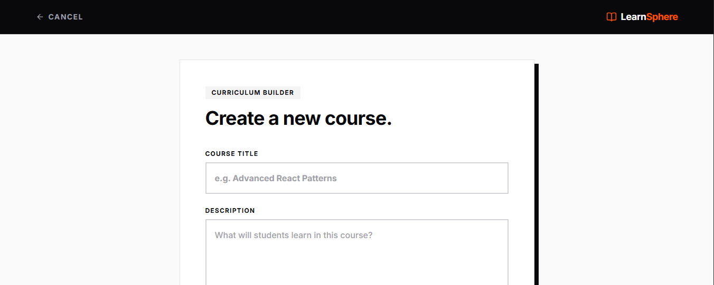
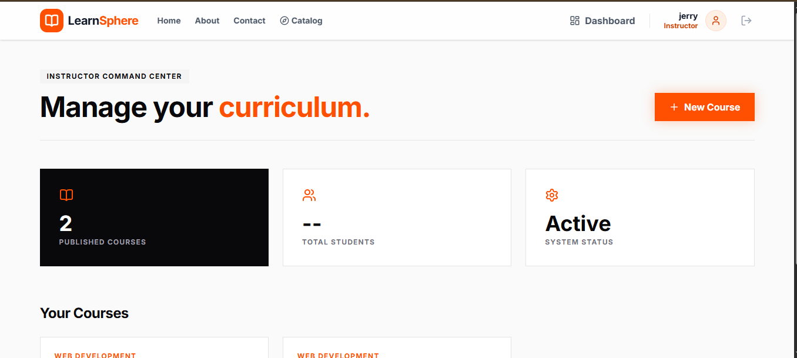

# LearnSphere 2.0 | Premium Learning Management System

A full-stack, role-based Learning Management System featuring a brutalist, high-end "stark studio" design language. Engineered for distraction-free deep work.

## Core Architecture
* **Frontend:** React.js, Tailwind CSS v4, Framer Motion, Lucide React
* **Backend:** Node.js, Express.js
* **Database:** MongoDB (Mongoose)
* **Authentication:** JWT (JSON Web Tokens) with strict Role-Based Access Control (RBAC)

## Key Features
* **Role-Based Workspaces:** Distinct automated routing for `Student` and `Instructor` dashboard views.
* **Distraction-Free Classroom:** Cinematic reading mode with interactive, lockable knowledge-check quizzes.
* **Automated PDF Certificates:** Client-side generation of brutalist-styled mastery certificates using `jsPDF`.
* **Dynamic Catalog:** Real-time search and category filtering for all published curriculums.

## 📸 Platform Previews

| Student Dashboard | Classroom Module |
| :---: | :---: |
|  |  |
